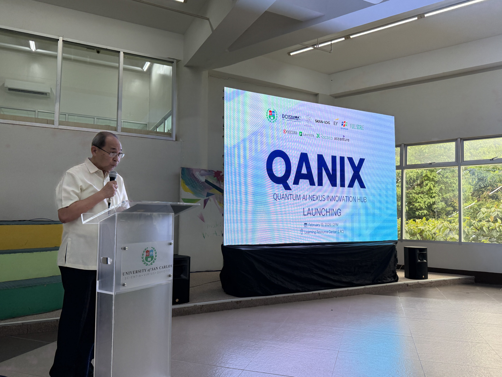
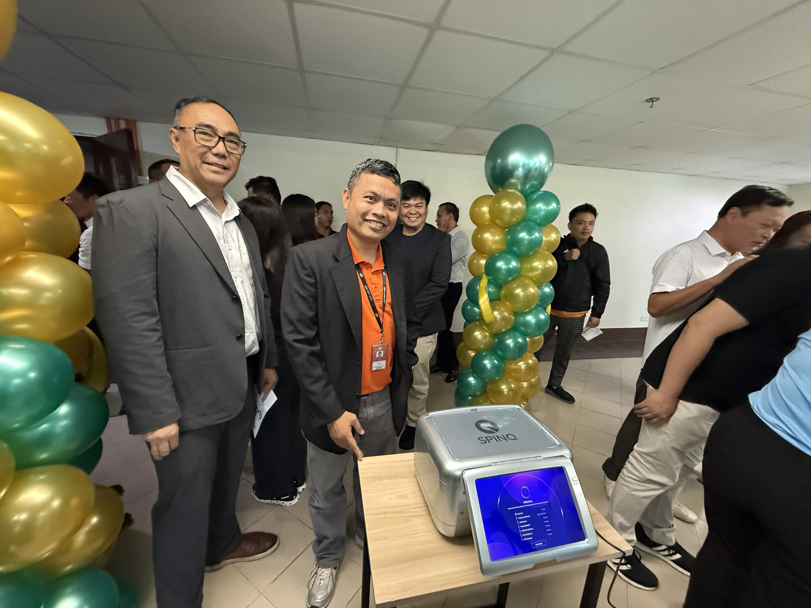

**CEBU CITY, Philippines** — The **University of San Carlos (USC)** launched the **Quantum-AI Nexus Innovation Hub (QANIX Hub)** on **February 19, 2026** at its Talamban Campus, becoming the first university in the Philippines with on-site quantum computing equipment.

|  |
|:--:|
| *The launch of the QANIX Hub at the Learning Resource Center of USC's Talamban Campus.* |

## A Hub for Quantum and AI

QANIX brings together academe, government, and industry to speed up research, innovation, and talent development in quantum computing and artificial intelligence. The hub equips learners with knowledge in quantum information science and AI, and the program also aims to advance research, promote ethical and sustainable innovation, foster collaboration with industry and government, and support societal transformation.

With the hub in place, students and faculty gain access to quantum computing systems, which USC plans to use to train students, support research, and explore applications in science, engineering, and data analysis. The hub features **SpinQ Gemini Mini** systems.

|  |
|:--:|
| *A SpinQ quantum computer on display at the QANIX launch.* |

Vice President for Administration Atty. Joan Largo said the initiative reflects USC's commitment to offering relevant and transformative programs, and to preparing students for employment while building strong partnerships by bringing industry inside the institution. Among those present at the launch and the unboxing of the two quantum computers were USC President Fr. Francisco Antonio T. Estepa, SVD, PhD, and Fr. Jesuraj Anthoniappen, SVD, of the Department of Physics, who shared the hub's mission and vision. Fr. Anthoniappen said the hub aims to build capacity by giving learners knowledge in quantum information science and AI.

USC has partnered with several technology organizations as official partners of QANIX, including FPT Software, Full Scale, KYOCERA, EY, Rococo, Skan•Log, Lexmark, and Accenture.

The Department of Science and Technology Region VII (DOST-7) expressed its support for the initiative. DOST-7 Regional Director Dr. Tristan L. Abando said the hub aligns with the DOST Three-Horizon STI Economic Strategy, particularly Horizon 3, building the industries of the future, which promotes national capabilities in AI and quantum technologies.

## Building the Roadmap

On **April 6, 2026**, USC and DOST-7 met again to strengthen their collaboration after the launch and to set a roadmap for the hub. The meeting highlighted possible joint efforts to advance innovation and talent development under the DOST strategy, with the hub set to drive pilot projects, innovation initiatives, and training programs. The aim is to position Central Visayas as a growing center for emerging technologies by 2028, with QANIX also planning to focus on research and grant acquisitions by that year.

## A Long-Time Partner of QCSP

USC has been a steadfast supporter of the Quantum Computing Society of the Philippines. It was among QCSP's very first partners, together with Cebu Institute of Technology–University, in the first Quantum Computing Lecture Series and Hackathon in 2023, and it was one of the organizers of [QISTCon.PH 2025]({{site.baseurl}}/news/2025-08-01-qistcon-ph-2025/) in Cebu. QCSP congratulates USC, DOST-7, and the QANIX partners on this milestone for quantum education and research in the Philippines.

*Sources: University of San Carlos, DOST Central Visayas, and The Freeman.*
