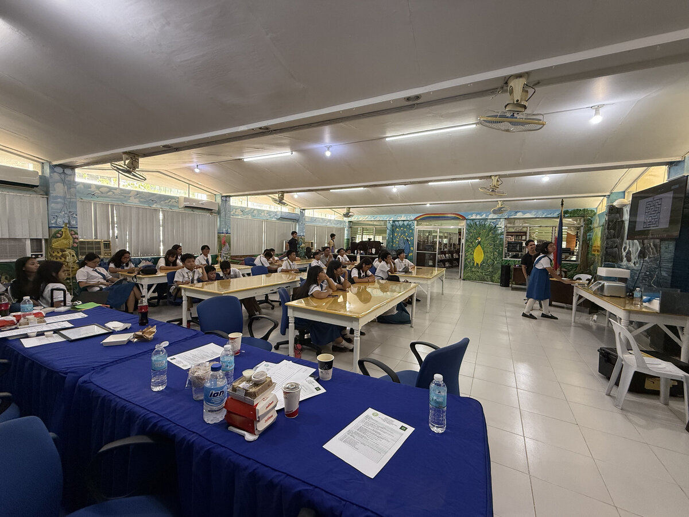

**CEBU CITY, Philippines** — **CTRL + C**, the coding, technology, and robotics learning club of **Cebu City National Science High School (CCNSHS)**, held **"Quantum Leap: Exploring the Future of Quantum Computing"** on **March 25, 2026** in the school library. The full-day program was co-organized with the Quantum Computing Society of the Philippines (QCSP). It aimed to raise students' awareness of quantum computing through expert talks, a hardware demonstration, and a project pitching contest.

## Morning Session

The program opened with welcome remarks from **Dr. Marilou Dela Cuesta**, the school principal; **Mr. Bryan Ibañez**, Provincial Director of DOST Region 7; and **Wilfredo "Jun" Sa-a Jr.**, President of the school's alumni association and a [QCSP Senior Adviser]({{site.baseurl}}/people/jun-sa-a.html). Together with QCSP President **Bobby Corpus Jr.**, they unveiled the **SpinQ Gemini**, a two-qubit desktop quantum computer made by SpinQ Technology. Students were then shown the machine's hardware.

Three speakers followed:

- **Dr. Cherry Lyn Sta. Romana**, Dean of the College of Computer Studies at Cebu Institute of Technology &ndash; University and a [QCSP Senior Adviser]({{site.baseurl}}/people/cherry-lyn-sta-romana.html), spoke on the importance of exploring tomorrow's technologies.
- **Bobby Corpus Jr.** introduced core concepts in quantum theory.
- **[Brian Siegelwax]({{site.baseurl}}/people/brian-siegelwax.html)**, a quantum algorithm designer, explained what quantum computing is.

The speakers were recognized for their contributions, and SSLG President **Bella Advincula** closed the morning session.

Asked about the students' awareness of quantum computing, Corpus said they are not yet really aware of it, and that the hope is to spark the curiosity of the high school students.

## Afternoon Session: Project Pitching

The afternoon began with **Julius Evangelio**, a QCSP fellow, who gave an overview of quantum computing and its applications.

A quantum-themed **project pitching contest** followed. Students were divided into teams (Teams A to E), who presented ideas for using quantum computing to solve real-world problems and answered questions from a panel of judges: Brian Siegelwax, Julius Evangelio, Ms. Merja Chongson of Mandaue City Comprehensive National High School, and Mr. Melchizedek Rodinas of CCNSHS.

| Place | Team | Prize |
|:--|:--|:--|
| 1st | Team E | PHP 3,000 |
| 2nd | Team C | PHP 2,000 |
| 3rd | Team A | PHP 1,000 |
| 4th | Team D | No prize |

|  |
|:--:|
| *Students in the school library during the program.* |

The leader of the winning team said the pitching activity helped them learn more and apply what they had learned. It is a reminder that hands-on, engaging activities help students understand difficult topics such as quantum computing.

The afternoon speaker and the judges were recognized for their part in the program's success. Corpus shared more about QCSP and closed the program. The club plans to keep partnering with technology groups and universities to raise awareness of quantum computing.

## Why It Matters

Student-led events like this one introduce quantum computing at the high school level, before students choose a university course or a career. CCNSHS has been part of Cebu's quantum community for some time: its students were among the registrants of the [2023 Cebu quantum computing hackathon]({{site.baseurl}}/news/2023-09-24-cebu-hackathon/).

## Credits

The event was covered in *The Premier*, the school's broadcast, with reporters **Feliz Juariza**, **Triz Alenton**, and **Beatriz Putian**. The executive producers were Mr. Rex C. Ebarle, Mrs. Allyssa G. Bautista, and Mrs. Yena M. Sanchez; the director and scriptwriter was Carmelli Ybañez; and the video team was Lyra Malaki, Cathleen Roden, Patrice Osorio, and Almer Piala.

QCSP congratulates CTRL + C and CCNSHS for the initiative.
