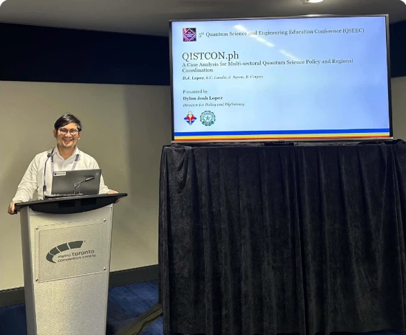

**TORONTO, Canada** — A paper on **QISTCon.PH**, the Philippines' Quantum Information, Science and Technology Conference, was presented at the **5th Quantum Science and Engineering Education Conference (QSEEC)** during **IEEE Quantum Week 2026**, held at the Metro Toronto Convention Centre.

|  |
|:--:|
| *Dylan Josh Lopez presents the QISTCon.PH paper at QSEEC during IEEE Quantum Week 2026 in Toronto.* |

The paper, **"QISTCON.ph: A Case Analysis for Multi-sectoral Quantum Science Policy and Regional Coordination,"** was written by Dylan Josh Lopez, Kyle Lasala, Jabez Ayson, and QCSP President Bobby Corpus, and presented on site by Lopez. It represented the Quantum Computing Society of the Philippines (QCSP) and the De La Salle University College of Computer Studies.

## What the Paper Discusses

The paper examines how a conference such as [QISTCon.PH 2025]({{site.baseurl}}/news/2025-08-01-qistcon-ph-2025/), which brought researchers, industry leaders, educators, and policymakers together in Cebu, can be used to advance science policy and science diplomacy in the region. It highlights frameworks for quantum science policy, education, and cross-sector strategic collaboration, drawing on the experience of organizing QISTCon.PH.

## Support from the IEEE Computer Society Philippine Chapter

The IEEE Computer Society Philippine Chapter congratulated its members Lopez, Lasala, Ayson, and Corpus on the paper, noting that it represented the Philippine computing and quantum research community on the global stage. Lopez thanked the chapter for its support of the community and said he hopes for stronger Philippine representation at the conference next year.

QCSP congratulates the authors on bringing the QISTCon.PH experience to an international audience.
