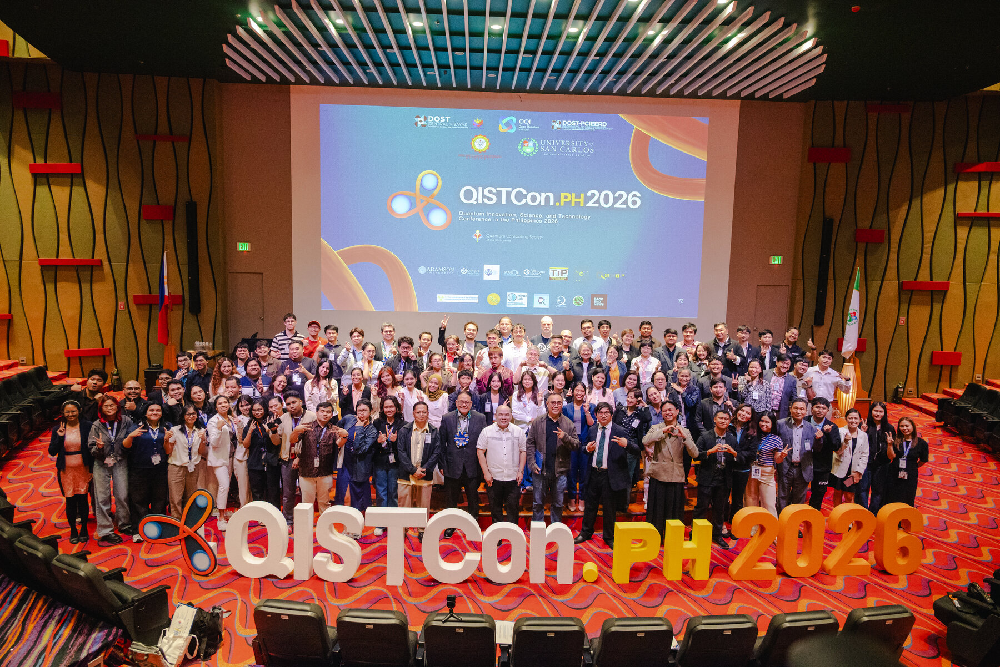
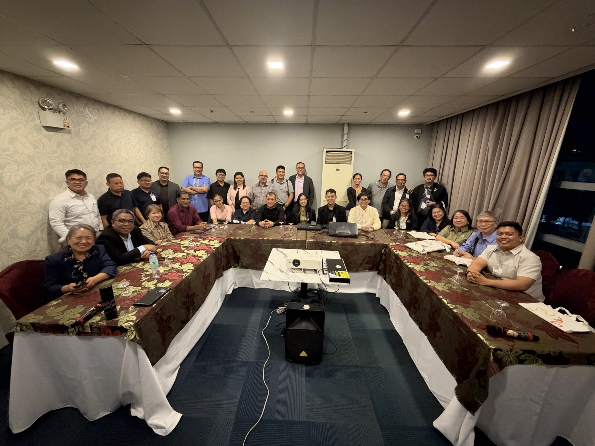

**CEBU CITY, Philippines** — Researchers, educators, industry representatives, government officials, and students came together for **QISTCon.PH 2026** on **November 9–11** at the University of San Carlos–Talamban Campus, placing quantum research, cybersecurity readiness, and regional collaboration on a shared agenda.

|  |
|:--:|
| *Participants and organizers gather for a group photo at QISTCon.PH 2026.* |

Organized by the Quantum Computing Society of the Philippines (QCSP), the Quantum Innovation, Science, and Technology Conference carried the theme **"Shaping the Quantum Future: From National Innovation to Regional Impact."** The main conference took place on November 10–11 at Michael Richartz Hall, following a day of pre-conference learning activities.

The conference was led by **Dylan Josh Lopez**, QCSP's Director for Policy and Diplomacy, who served as lead organizer.

## Pre-Conference and National Priorities

The November 9 program offered four parallel tracks covering quantum education, introductory programming, energy applications, and space and disaster risk reduction and management. Sessions ranged from demonstrations of light polarization and Qiskit programming to research on power-system optimization, Earth observation, and disaster-response planning.

The main program connected these practical learning opportunities with national priorities. Engr. Niñaliza H. Escorial of DOST-PCIEERD was featured in the Philippine quantum technology update, while Dr. Eric Galapon of UP Diliman presented the national quantum science and technology roadmap. A Philippine quantum ecosystem panel brought together perspectives from government research agencies, universities, laboratories, and QCSP.

## International Contributions

International contributions addressed several directions in the field. Dr. Rodney Van Meter of Keio University covered scalable quantum computing; Julian Tan of IBM Singapore provided an update on IBM's roadmap and partnerships; and Dr. Angelina Frank of QAI Ventures examined quantum technology supply chains. The program also featured the Asian Development Bank's quantum innovation challenge for disaster risk financing and Dr. Jianlong Lu of the National University of Singapore on adaptive algorithmic control.

## Quantum-Safe Security

Quantum-safe security was a prominent part of the second day. QCSP President Bobby Corpus Jr. moderated a panel with Philip Casanova of SGV/EY, Olga Mamlyga of Quantum Scouts, and Jeffrey Serrano of Securemetric. The session connected the conference's research agenda with the practical readiness concerns facing organizations that depend on secure digital systems.

This focus continued work begun at QCSP's April [Quantum Readiness Workshop]({{site.baseurl}}/news/2026-04-24-quantum-readiness-workshop-dap/) with IBM, DOST, DAP, and other partners. That earlier gathering identified gaps in expertise, infrastructure, funding, and coordination across Philippine sectors, alongside the need for cryptographic inventories, workforce development, and carefully selected pilot projects.

## Education and Regional Cooperation

Education received its own place in the conference program through a presentation by Dr. John M. Donohue of the University of Waterloo and a panel on quantum education and science communication. These sessions complemented the pre-conference activities by addressing how learners, teachers, and wider audiences can engage with quantum science.

Regional cooperation also featured prominently, with a panel bringing together perspectives from across Southeast Asia. The program reflected QCSP's continuing effort to connect Philippine institutions with neighboring quantum communities and international partners.

## Working Groups and Networking

The final afternoon provided space for working groups on science and digital policy; quantum education, communication, and inclusivity; and quantum diplomacy. Participants could also join the Quantum Diplomacy Game, a simulation of stakeholder negotiations, or a leadership workshop. These activities were designed to develop ideas and recommendations for continued cooperation, with time allocated for group reports and synthesis.

Poster viewing and the conference dinner provided further opportunities for participants to meet and exchange research interests beyond the formal sessions.

## A Proposed University Network

Alongside the conference, QCSP advanced discussions on a proposed Philippine university network linked to the NUS-led IBM Quantum Innovation Center. The initiative remains under development, with participating institutions exploring arrangements for research collaboration, capacity building, and access to quantum computing resources.

|  |
|:--:|
| *Discussions on the proposed Philippine university network linked to the NUS-led IBM Quantum Innovation Center.* |

## Thank You, Volunteers

QCSP extends its heartfelt thanks to the **30 volunteers** whose time, dedication, and hard work helped make QISTCon.PH 2026 a successful event. Their contribution reflects the spirit of service and collaboration at the heart of the organization.

For QCSP, the work following QISTCon is to sustain those connections: supporting educators, bringing researchers and institutions together, and helping government and industry prepare for the opportunities and challenges of quantum technologies.
