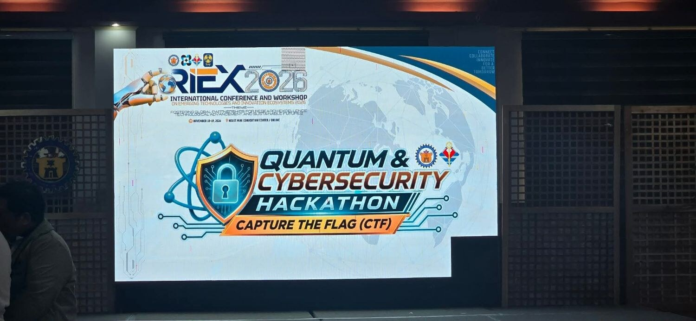
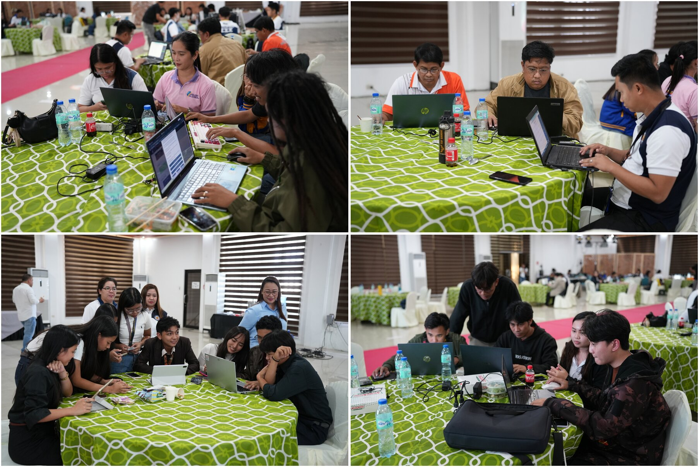
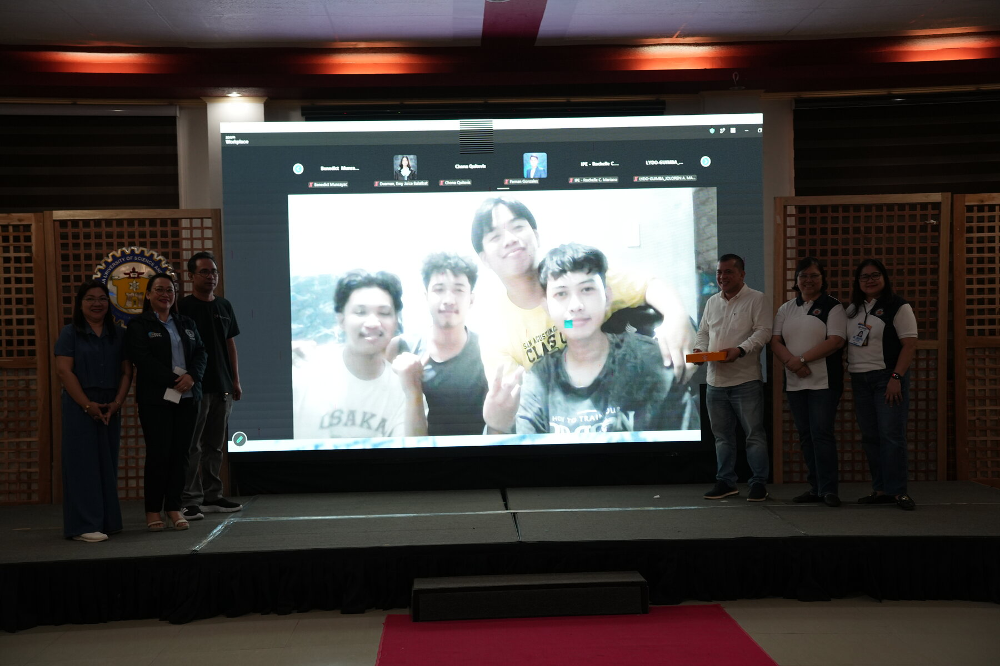

**NUEVA ECIJA, Philippines, November 19, 2026** — Nine teams competed in the **Quantum and Cybersecurity Hackathon: Capture the Flag (CTF)** held during the second day of **RIEx 2026**, the International Conference and Workshop on Emerging Technologies and Innovation Ecosystems, at the **Nueva Ecija University of Science and Technology (NEUST)**. **Team ITBoyz** emerged as champion.

|  |
|:--:|
| *The Quantum and Cybersecurity Hackathon: Capture the Flag (CTF) was part of the RIEx 2026 program.* |

The hackathon was organized as part of RIEx 2026, which the Quantum Computing Society of the Philippines (QCSP) co-organized with NEUST. It followed [NEUST's hosting of the Luzon leg]({{site.baseurl}}/news/2026-06-06-neust-quantum-cybersecurity-hackathon/) of QCSP's nationwide Quantum Computing and Cybersecurity Hackathon earlier this year, and was previewed in the [RIEx 2026 announcement]({{site.baseurl}}/news/2026-10-03-riex-2026-neust/).

## The Program

**Dr. Joseph Del Carmen**, Quantum Computing Research Coordinator, opened the hackathon. **Engr. Orlando Ritchie R. Natonton**, the Game Master, then introduced participants to **Ghostnet**. Engr. Natonton teaches Industrial Engineering at Father Saturnino Urios University in Butuan City.

Congratulatory messages came from **Bobby Corpus**, President of QCSP, and **Dr. Marlon Torres**, MIS Director.

|  |
|:--:|
| *Teams work through challenges during the Capture-the-Flag competition.* |

## The Winners

After the competition, the results were announced at the awarding ceremony:

| Placing | Team |
|:--|:--|
| **Champion** | **ITBoyz** |
| **1st Runner-up** | **Nova** |
| **2nd Runner-up** | **0xC0FEE0V3RD05E** |

The champion team, **ITBoyz**, is composed of **Lester B. Alfonso, Delwin F. Galang, Edrhei Evangelista, Carl Andrew B. Bernaldo, and Ethan Jerome G. Medina**.

|  |
|:--:|
| *Team ITBoyz joins the awarding ceremony by video call.* |

The event closed with remarks from **Dr. Jean Guillasper**, Vice President for Research, Extension, and Training of NEUST.

QCSP congratulates ITBoyz, Nova, and 0xC0FEE0V3RD05E, thanks all nine teams for taking part, and thanks NEUST for hosting the hackathon.
