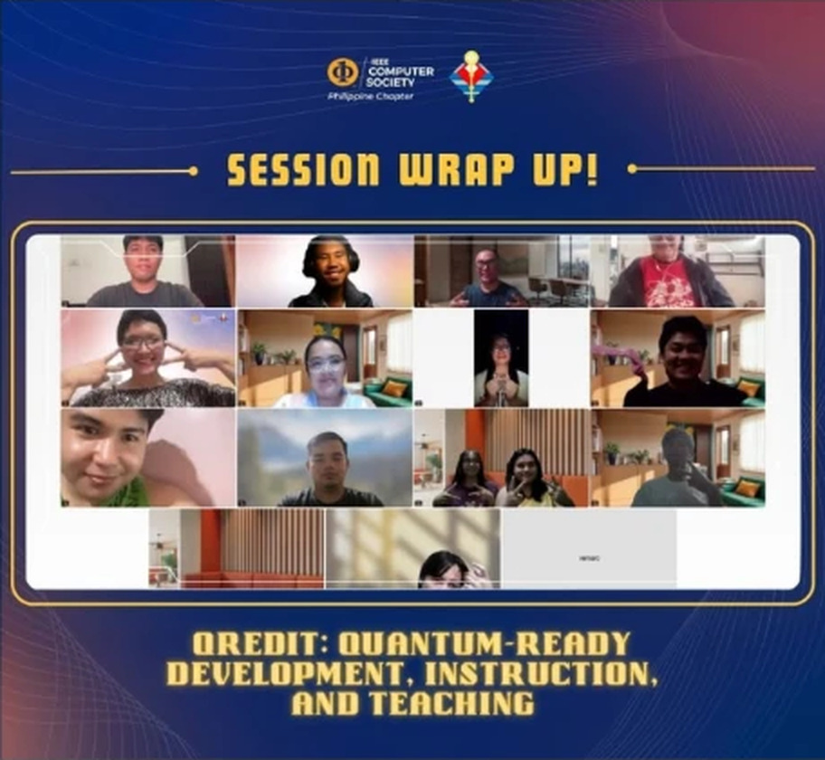

The **Alice in Quantumland Training Workshop** was held on **November 21, 2026** via Webex as part of the **Q-ReDIT (Quantum Ready Development, Instruction, and Training)** series, co-organized by the Quantum Computing Society of the Philippines (QCSP) and the **IEEE Computer Society Philippine Chapter**.

## The Speaker and the Approach

The session was led by **Dr. Pere Juarez Vives** of the **University of Barcelona**. He presented an educational methodology co-developed with **Dr. Maria Luisa Chiofalo** of the University of Pisa under the **Qubricks** toolbox, which is aligned with the UNESCO quantum agenda.

The approach is built on **constructivism and active learning**. It uses gamification, LEGO-based concepts, and metaphors in place of passive lectures, with the aim of making quantum literacy available to both STEM students and the broader public.

|  |
|:--:|
| *Participants and the speaker at the close of the Alice in Quantumland Training Workshop.* |

## Part 1: Quantum Reversibility (A Board Game Activity)

Participants played a modified digital version of **Snakes and Ladders** on Miro, using online dice to track Alice's 10-roll journey across squares with ladders, snakes, clocks (wait two turns), and a reset square (return to square 1).

They then simulated erasing one move from their logs. This brought out the difference between two ideas:

- **Reconstruction**: discovering what happened in the past.
- **Reversibility**: applying an inverse operation to undo an effect. Applying a quantum $X$ gate twice restores the original state, while a reset operation cannot be undone.

The activity also touched on **uncomputation** and **environmental decoherence**. The session ended with a live Slido quiz that reinforced these concepts.

## Part 2: Quantum Citizenship ("The Lost Memory of Quantumland")

The second part was an asynchronous, collaborative exercise on Miro built around three "mysterious doors": the **White Rabbit**, the **Queen of Hearts**, and the **Mad Hatter**. Participants posted reflections on three questions:

- Who should have access to quantum knowledge?
- Who governs quantum technologies?
- How will quantum shape the future?

The exercise draws on philosopher José Antonio Marina's idea of shared intelligence as a common good. It calls on society to move from passive observers to active, critically engaged participants.

## Q&A Highlights

- **Low-resource adaptation:** Prof. Vives confirmed that the Qubricks toolkit is open source (Creative Commons). It can be run offline in public schools with printed game boards, physical dice, and paper.
- **Entry points and regulation:** For beginners without a physics background, he recommended sparking curiosity and surprise. He also stressed collaborating early with regulators and legacy institutions to build trust around post-quantum cryptography (PQC) and other emerging technologies.

## What's Next

QCSP President **Bobby Corpus Jr.** formally invited Prof. Vives to conduct an **in-person workshop next year** in partnership with **UP NISMED** (National Institute for Science and Mathematics Education Development), to help develop a high school quantum curriculum. See the earlier [announcement on QCSP and UP NISMED]({{site.baseurl}}/news/2026-10-01-up-nismed-quantum-basic-education/) for background.

Two more webinars in the Q-ReDIT series were announced:

- **Developing Expertise in Quantum Computing** with Himanshu Thapliyal (November 28)
- **Quantum Technology for Educators** with Olga Mamlyga (November 30)

QCSP thanks Prof. Vives, the IEEE Computer Society Philippine Chapter, and all participants. Follow the [events page]({{site.baseurl}}/events.html) for updates.
