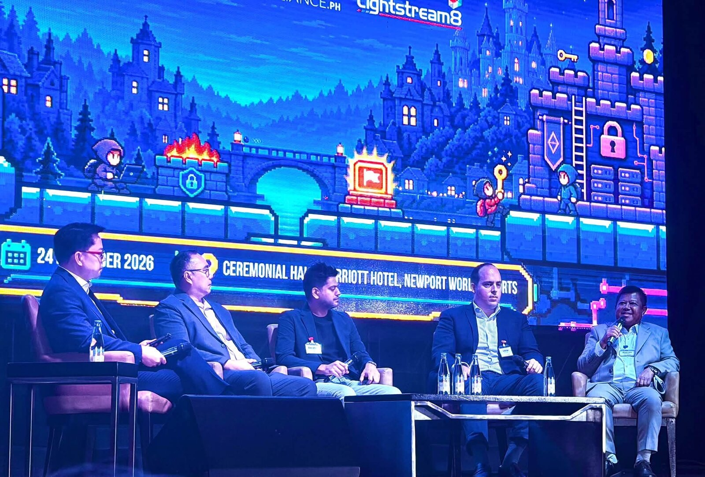
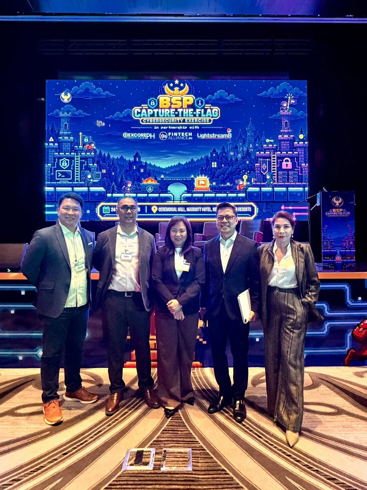

**PASAY CITY, Philippines** — Quantum computing was on the agenda at the **Bangko Sentral ng Pilipinas (BSP) Capture-the-Flag (CTF) Cybersecurity Exercise and Executive Roundtable Session (ERS)**, held on **November 24, 2026** at the Ceremonial Hall of the Manila Marriott Hotel, Newport World Resorts. Quantum Computing Society of the Philippines (QCSP) President **Bobby O. Corpus Jr.** served as the quantum speaker in the opening panel.

The event was held in partnership with FinTech Alliance PH and Lightstream8. The CTF ran from 8:00 AM to 5:00 PM, and the Executive Roundtable Session from 8:00 AM to 1:00 PM.

|  |
|:--:|
| *The opening panel at the BSP Capture-the-Flag and Executive Roundtable Session, Manila Marriott Hotel, Newport World Resorts.* |

## Opening Ceremony

The opening ceremony brought together participants of both the Capture-the-Flag exercise and the Executive Roundtable Session. After registration, Deputy Governor **Lyn I. Javier** of the BSP gave the welcome remarks.

The ceremony then moved to **Expert Perspectives and a Moderated Panel Discussion**, moderated by **Lito Villanueva** of FinTech Alliance PH. Each panelist spoke on a different frontier of the cybersecurity landscape:

| Topic | Speaker |
|:--|:--|
| **Frontier AI** | Viktor Pozgay, Palo Alto Networks |
| **API Exploits** | Darshan Shivashankar, APIWiz |
| **Quantum** | Bobby Corpus, QCSP |
| **Practitioner Perspective** | Warren R. Bituin, SGV |

Placing quantum computing alongside AI and API security on the same panel reflects how financial-sector regulators and institutions now view it: as one of several fast-moving technology risks that need to be planned for together.

## Executive Roundtable Session

After a coffee break, the Executive Roundtable Session continued the discussion among senior participants. **Florabelle M. Santos-Madrid** of the BSP opened the session and presented its objectives, followed by two roundtable discussions:

- **Roundtable Discussion 1: Navigating Emerging and Interconnected Technology Risks**, led by **Eugene C. Teves** of the BSP.
- **Roundtable Discussion 2: Advancing Collective Cyber Resilience Through Collaboration**, led by **Cesar Santos Jr.** of BAPDEX.

The session closed with a synthesis of key insights, closing remarks, and next steps from Lito Villanueva, followed by an optional networking lunch.

|  |
|:--:|
| *Speakers and organizers in front of the event's stage, Manila Marriott Hotel, Newport World Resorts.* |

## Why It Matters

Quantum computing is increasingly treated as a security planning issue today, and not only as a research topic. Sufficiently powerful quantum computers could break widely used public-key cryptography, and encrypted data captured now could be decrypted later, so financial institutions are being urged to take stock of their cryptography and plan their migration early.

QCSP has been working on this with the BSP. In August it conducted a [one-day quantum computing and quantum readiness workshop]({{site.baseurl}}/news/2026-08-28-bsp-quantum-readiness-workshop/) for BSP personnel at the BSP Head Office.

QCSP thanks the Bangko Sentral ng Pilipinas for the invitation, and the organizers, panelists, and participants of the Capture-the-Flag and Executive Roundtable Session.
